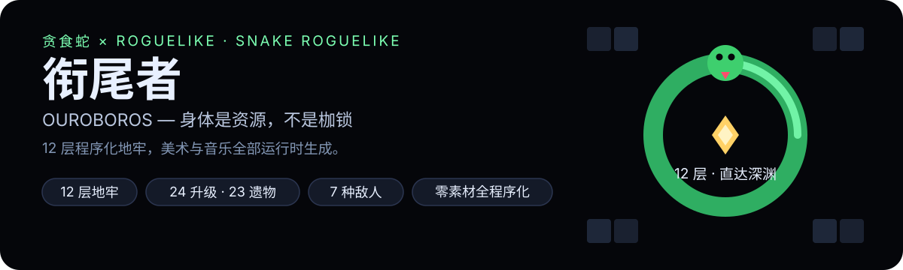
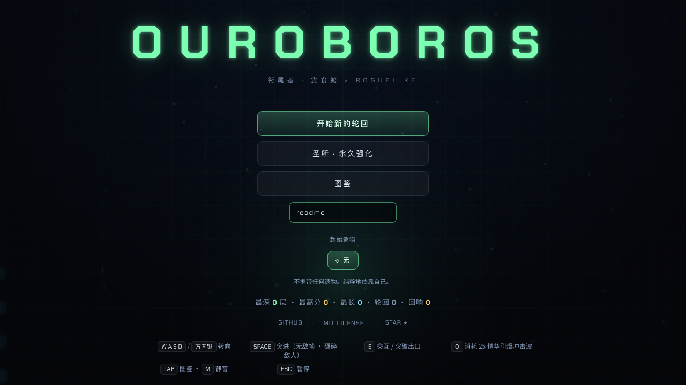
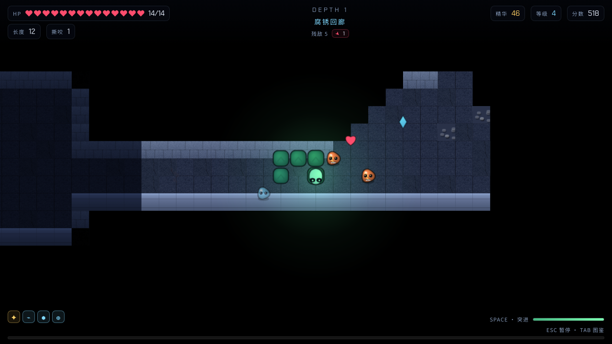

<p align="right"><a href="README.md">中文</a></p>

<p align="center">
  
</p>

<p align="center">
  <a href="https://holynova.github.io/ouroboros-rogue-snake/">▶ Play Online</a>
  ·
  <a href="https://github.com/holynova/ouroboros-rogue-snake">GitHub Repository</a>
</p>

OUROBOROS is a snake × roguelike dungeon crawler: pilot a snake through 12 procedurally generated dungeon depths, eat enemies, gather essence, pick 1-of-3 upgrades, and build a relic loadout down to the abyss. The core rule is flipped — your body is a resource, not a trap: running over yourself costs 1 HP and digests 20% of your length, and length converts into damage, score, and overflow essence. Zero asset files: all art and music are generated at runtime.

## Screenshots

<p align="center">
  
  
</p>

## How to Play

- **Steer**: WASD / arrow keys; buffered input, latest intent always wins; hitting a wall only drops the tile that would hit the wall again.
- **Dash**: Space (i-frames, crushes enemies); **Shockwave**: Q (costs 25 essence).
- **Interact**: E (interact / break through the exit); **Codex**: Tab; **Pause**: Esc; **Mute**: M.
- **Body as resource**: crossing yourself costs 1 HP and digests 20% of your length, but you keep moving; walls stop you in place until you steer away; standing still for 1.1 s triggers a forced turn, so you can never get stuck.
- **Growth**: level up to pick 1 of 3 upgrades; length counts toward score and overflows into essence past a soft cap; 「消化」 ("Digest") upgrades convert length directly into damage.

## Content

- **12 dungeon depths**: rooms + 2-tile-wide corridors, with loops, rubble, and pits; the same seed always generates the same map.
- **7 enemy types**, each with ranged barrages, summoning, wall-phasing, death explosions, and other behaviors; enemy AI recomputes a BFS distance field from the player every 0.4 s.
- **24 upgrades, 23 relics** (three rarity tiers, including flag-type passives); **Sanctum** (圣所): 6 permanent upgrades + 5 starting relics, saved in localStorage.
- **Codex**: enemies / relics / upgrades / starting relics, with unencountered entries shown as `???`.
- **Vision**: real-time 480-ray FOV (14 Hz) with wall occlusion and memory.
- **Music**: purely Web Audio generative soundtrack, a 16th-note scheduler with four layers (bass / arpeggio / pad / drums) that shifts mode and speeds up as you descend; 20 sound effects, all synthesized oscillators + envelopes + noise.
- **No mid-run saves**: a run ends when you finish it or die (roguelike by design); progress lives in your browser, and clearing site data removes saves.

## Run Locally

```bash
npm ci
npm run dev      # Vite dev server
npm run build    # Production output to docs/
npm test         # 20 acceptance + 10 steering tests
```

## Tech

- Phaser 3.90 + Vite; the canvas draws only the game world (Phaser + WebGL), all text UI goes through the DOM.
- Fixed-timestep deterministic simulation: all logic steps at 1/60 s, so dropped frames only make the picture choppy — never change game speed.
- Zero assets: `src/art.js` draws every texture at runtime with Canvas2D (tiles, snake body, pickups, creatures, particles); `src/audio.js` synthesizes music and sound effects with Web Audio.
- Seeded randomness (mulberry32): the same input always generates the same dungeon and the same run.

```
src/main.js         Phaser boot, scene state machine, global hotkeys, UI event bridge
src/dungeon.js      Room/corridor generation, BFS distance field, reachable random points
src/run.js          Single-run state: stats, XP, upgrades, relics, essence, results
src/data.js         Enemy / upgrade / relic / starting relic stat tables
src/meta.js         Sanctum: permanent upgrades, unlocks, localStorage saves
src/art.js          Procedural texture generation
src/audio.js        Procedural music and sound effects
src/ui.js           All DOM interfaces: title, HUD, card draws, codex, sanctum, pause, results
src/scenes/         GameScene (main gameplay), MenuScene (animated title background)
```

Design details in `DEVELOPMENT.md`.

## License

MIT, see `LICENSE`.
