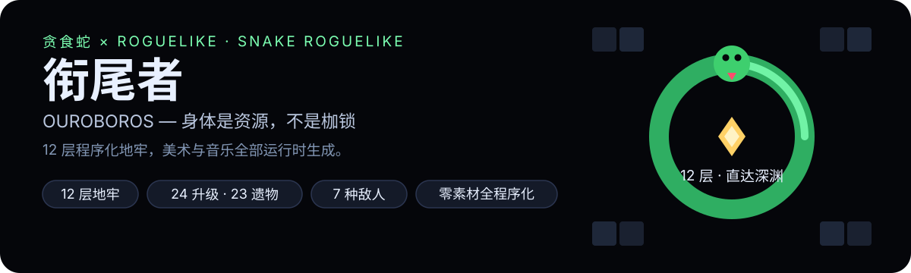
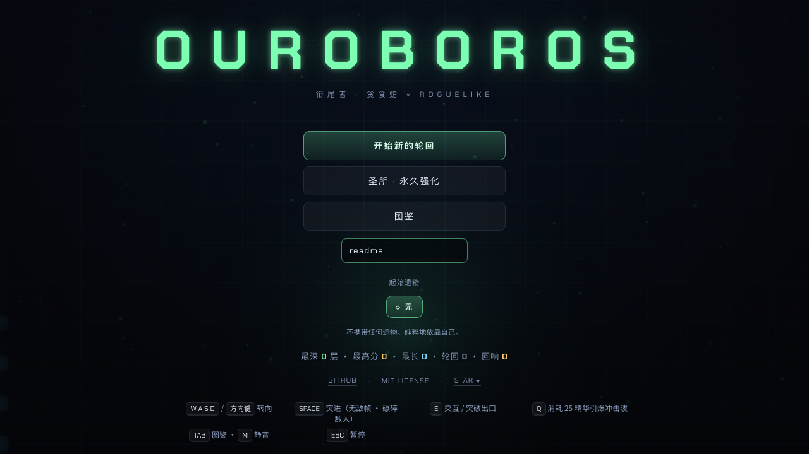
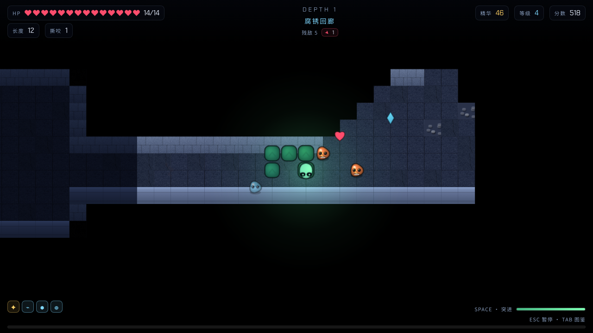

<p align="right"><a href="README.en.md">English</a></p>

<p align="center">
  
</p>

<p align="center">
  <a href="https://holynova.github.io/ouroboros-rogue-snake/">▶ 在线玩</a>
  ·
  <a href="https://github.com/holynova/ouroboros-rogue-snake">GitHub 仓库</a>
</p>

衔尾者是贪食蛇与地牢肉鸽的结合：你在 12 层程序化地牢里操控一条蛇，吃掉敌人、拾取精华、三选一升级、构筑遗物，一路打到深渊。核心规则被反了过来——身体不是枷锁而是资源：压到自己只掉 1 血并消化 20% 长度，长度能换伤害、进分数、溢出成精华。美术与音乐没有任何素材文件，全部在运行时程序化生成。

## 截图

<p align="center">
  
  
</p>

## 玩法

- **转向**：WASD / 方向键；输入带缓冲，最新意图永远胜出，撞墙只丢会重新撞墙的那一格。
- **突进**：Space（无敌帧，可碾碎敌人）；**冲击波**：Q（消耗 25 精华）。
- **交互**：E（交互 / 突破出口）；**图鉴**：Tab；**暂停**：Esc；**静音**：M。
- **身体是资源**：压到自己掉 1 血、消化 20% 长度但继续前进；撞墙停在原地等转向；1.1 秒完全不动触发强行转身，永不卡死。
- **成长**：升级三选一；长度进分数，超过软上限溢出成精华；「消化」类升级把长度直接换算成伤害。

## 内容

- **12 层地牢**：房间 + 2 格宽走廊，含循环边、碎石、深坑；同一种子必然生成同一张地图。
- **7 种敌人**：各有射程弹幕、召唤、穿墙、死亡自爆等行为；敌人 AI 每 0.4 秒从玩家位置重算 BFS 距离场。
- **24 种升级、23 件遗物**（三档稀有度，含 flag 型被动）；**圣所**：6 条永久强化 + 5 种起始遗物，存 localStorage。
- **图鉴**：敌人 / 遗物 / 升级 / 起始遗物，未遭遇显示 `???`。
- **视野**：480 条射线的实时 FOV（14Hz），带墙体遮挡与记忆。
- **音乐**：纯 Web Audio 生成式配乐，16 分音符调度器，四层（贝斯 / 琶音 / 铺底 / 鼓组），随层数切换调式并提速；20 种音效全为合成振荡器 + 包络 + 噪声。
- **无中途存档**：一局要么打完要么结束（Roguelike 本意）；进度保存在本机浏览器，清理站点数据会移除存档。

## 本地运行

```bash
npm ci
npm run dev      # Vite 开发服务器
npm run build    # 生产产物输出到 docs/
npm test         # acceptance 20 项 + steering 10 项
```

## 技术

- Phaser 3.90 + Vite；Canvas 只画游戏世界（Phaser + WebGL），所有文字界面走 DOM。
- 固定步长确定性模拟：逻辑一律以 1/60 秒定长步进，掉帧只让画面变卡、不改变游戏速度。
- 零素材：`src/art.js` 用 Canvas2D 运行时绘制全部贴图（地砖、蛇身、拾取物、生物、粒子）；`src/audio.js` 用 Web Audio 合成配乐与音效。
- 种子随机（mulberry32）：同一输入必然生成同一地牢与同一局。

```
src/main.js         Phaser 启动、场景状态机、全局快捷键、UI 事件桥
src/dungeon.js      房间/走廊生成、BFS 距离场、可达随机点
src/run.js          单局状态：属性、经验、升级、遗物、精华、结算
src/data.js         敌人 / 升级 / 遗物 / 起始遗物 数值表
src/meta.js         圣所：永久强化、解锁、localStorage 存档
src/art.js          程序化贴图生成
src/audio.js        程序化音乐与音效
src/ui.js           全部 DOM 界面：标题、HUD、抽卡、图鉴、圣所、暂停、结算
src/scenes/         GameScene（主玩法）、MenuScene（标题动态背景）
```

设计细节见 `DEVELOPMENT.md`。

## 许可

MIT，见 `LICENSE`。
